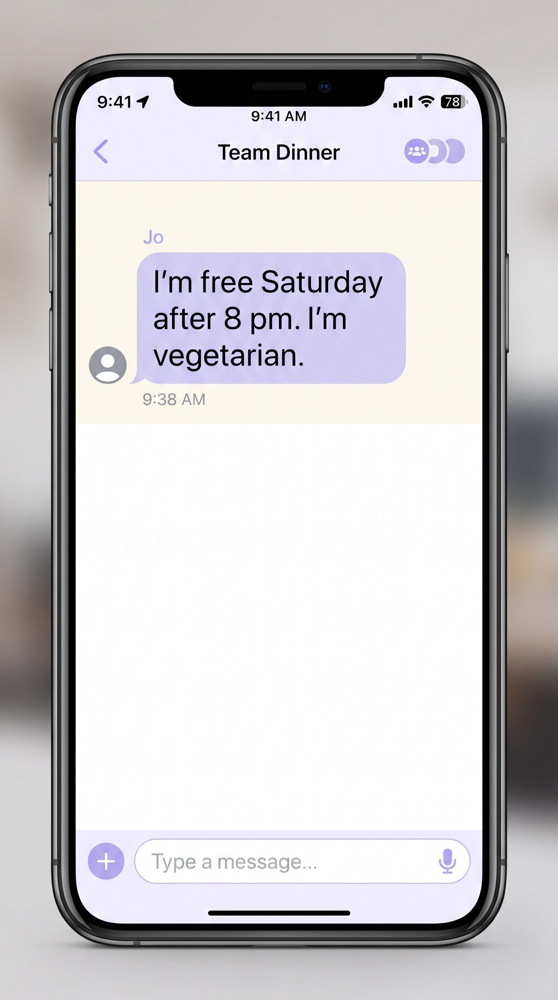
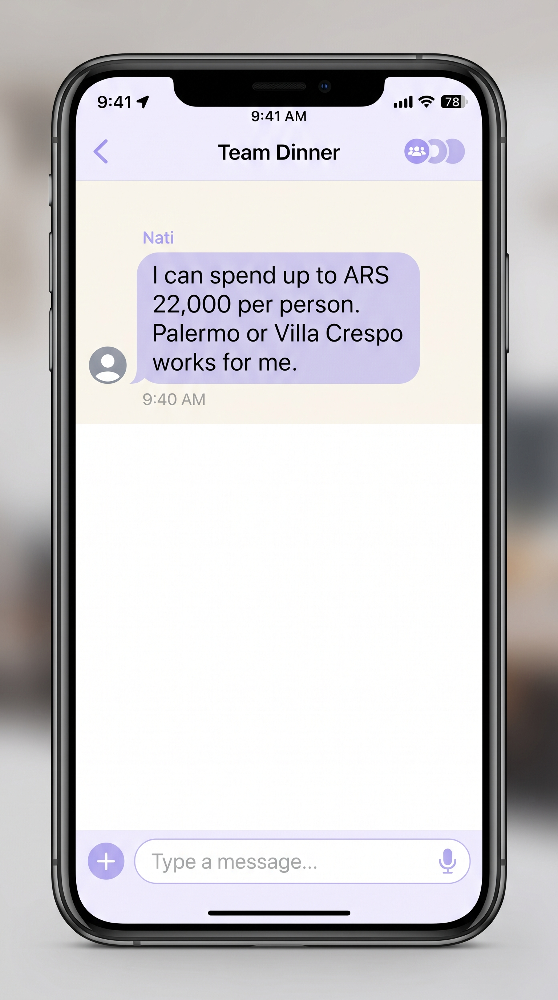

[English](README.md) · [Español](README_ES.md) · [**Technical README**](TECHNICAL-README.md)

  

<h1 align="center">APORIA</h1>

<strong>We want to see each other. Planning should feel just as good.</strong>

The shared space that turns scattered conversations, different schedules, budgets, and personal needs into plans people can make together.

<a href="https://aporia-bbb3f7.webflow.io/"><strong>Experience APORIA</strong></a> · <a href="#the-experience">Explore the experience</a> · <a href="TECHNICAL-README.md">Under the hood</a>

---

## Everyone wants to meet. So why is making plans so difficult?

It starts with something simple:

*“We should do something this weekend.”*

Then real life joins the conversation.

Someone can only make it after work. Someone has a budget to consider. Someone needs a particular food option. Another person is coming from a different neighborhood. A screenshot gets forwarded, a time gets suggested, somebody replies hours later, and the conversation moves on.

None of these details is a problem on its own.

The difficulty comes from keeping all of them together.

Group chats are excellent for conversation. But when a conversation becomes a plan, important information can get buried in the timeline. People repeat themselves, suggestions are reconsidered, and decisions are made without everyone having the same picture.

**APORIA was built for the moment when a conversation needs to become a shared decision.**

It gives those differences a place to exist together.

## One room. Many perspectives. A plan everyone can understand.

APORIA is a collaborative planning experience built around a shared room.

A room brings together the people, conversations, and practical details involved in organizing a get-together. Messages, screenshots, schedules, budgets, preferences, and arrival constraints can all contribute to the same planning context.

Instead of treating each new message as an isolated fragment, APORIA helps participants build a common understanding of what the group is trying to arrange.

**Different lives. One shared plan.**

## The experience: from the first invitation to the final decision

### 01. Start with the people, not a form.

Every plan begins with a group.

Create a room and invite others through a shareable link or meeting number. Participants can browse the room before choosing to contribute.

The room becomes the common point of reference as the group develops its plans.

### 02. Let everyday information become useful.

People rarely describe their availability, preferences, and constraints in a perfectly structured way.

They write messages. They send screenshots. They mention a budget while discussing something else. They remember an arrival time halfway through the conversation.

APORIA is designed around that reality. Participants can contribute information in the forms they already use, including messages and screenshots, alongside explicit planning details.

 

### 03. Make understanding a collaborative act.

APORIA proposes a structured interpretation of contributed information. The contributor reviews the proposal and confirms what should enter the shared context.

This distinction is central to the experience:

**AI helps organize information. The person remains the authority on what they meant.**

### 04. Compare possibilities against what matters.

Once the group has confirmed its relevant details, APORIA compares planning options against the context participants have contributed: schedules, budgets, preferences, locations, and other constraints.

The comparison is handled by deterministic application logic. The group can understand why a possibility fits and where a conflict remains.

Sometimes the useful question is not simply *“Which option is best?”* It is *“What would need to change for another option to become possible?”*

### 05. Move forward with a shared understanding.

A successful plan is a decision that the people involved can understand and make together.

APORIA provides a common reference for that decision: what was contributed, what was confirmed, and how the available options relate to the group’s needs.

When the planning session is finished, the room can be closed. Its creator has a seven-day recovery window.

## A Friday night, three different realities

Alex finishes work late and needs an option that accommodates a later arrival.

Sam has a limited budget and wants to avoid an unexpectedly expensive evening.

Jordan needs vegan food and does not want to discover at the last minute that the chosen place has nothing suitable.

They all want the same thing: to spend time together.

But they do not have identical circumstances.

APORIA gives those considerations a shared context. The group can contribute its information, review what was interpreted, and compare possibilities against the details participants actually confirmed.

No one has to become the group’s unofficial project manager.

**The purpose is not to eliminate discussion. It is to make discussion more productive.**

## Thoughtful AI. Human decisions.

APORIA uses AI where interpretation is useful and deterministic code where consistency matters.

**AI interprets.** The model proposes structured information from messages and screenshots.

**People confirm.** Contributors review what the system understood before it enters the shared context.

**Code evaluates.** A deterministic evaluator compares plans against confirmed details and explains the outcome.

This separation is intentional.

AI helps the group understand its information. It does not get the final say.

**The best plan is not the one an AI chooses for you. It is the one your group can choose together.**

## Designed for the way people actually live

People have different schedules, financial circumstances, dietary requirements, travel distances, preferences, and communication habits.

Those differences are not interruptions to the planning process. **They are the planning process.**

APORIA treats them as information worth considering and makes the shared context visible while the group decides.

## Experience APORIA

[**Open the application →**](https://aporia-bbb3f7.webflow.io/)

Explore the shared-room experience and see how APORIA brings planning information together.

## Built for Build With AI: Basics

APORIA began on September 25, 2026, during the [Devpost Build With AI: Basics](https://learn-ai-basics.devpost.com/) submission period.

The official Devpost Learn Skill Pack informed the project’s scope, product requirements, and technical planning. The repository includes the planning documents and the interview record used during that process.

## Explore the engineering

The main README introduces the experience. The implementation and engineering decisions are documented separately.

| Explore | What’s inside |
| --- | --- |
| [Technical README](TECHNICAL-README.md) | Architecture, implementation, and technical details |
| [Privacy and data flow](docs/PRIVACY-DATA-FLOW.md) | How information moves through the system |
| [Red-team documentation](docs/red-team/APORIA-ROUND-PLAN.md) | Security and robustness evaluation |
| [Project scope](devpost/scope.md) | Product boundaries and intended functionality |
| [Product requirements](devpost/prd.md) | Requirements and product decisions |
| [Technical specification](devpost/spec.md) | Detailed engineering specification |

## Different lives. One shared plan.

We make plans because we want to be together.

The tools we use to organize those moments should help us get there.

**APORIA — We want to see each other. Planning should feel just as good.**

[Experience APORIA](https://aporia-bbb3f7.webflow.io/)

---

Apache License 2.0 — see [LICENSE](LICENSE).
