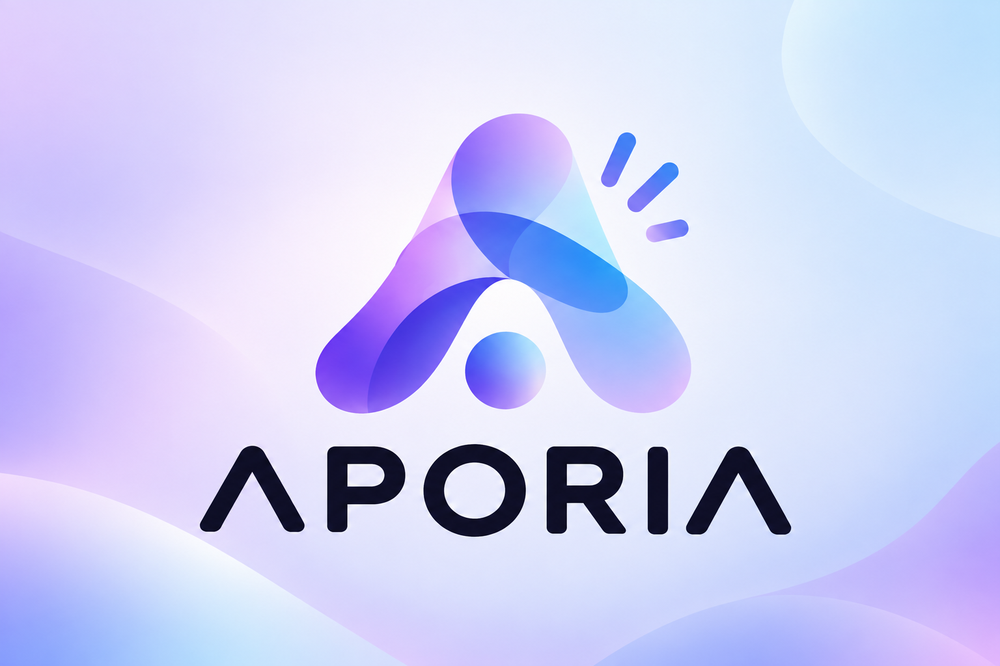

# APORIA

  

**Stop arguing. Start planning.**

[English](README.md) · [Español](README_ES.md) · [Technical README](TECHNICAL-README.md) · [**Previous Webflow beta →**](https://aporia-bbb3f7.webflow.io/)

> Drop the messages, screenshots and preferences. APORIA finds the plans that actually work for everyone.
>
> And when nothing works, it tells you **what needs to change.**

## You know this exact feeling

Someone starts a group chat. "When are we free this week?"

Twelve replies later, nobody has answered the actual question. One person pastes a screenshot of their calendar. Someone else says "whenever, I don't mind" — which is the least useful sentence in human history. Somebody quietly has a budget they haven't mentioned. Somebody else can't say out loud that they don't want to go somewhere far, so the plan just... stalls.

Nobody is wrong. Coordinating people was never designed to work this way. We just got used to it hurting.

## So we built the thing we wished existed

You don't fill out a form. You don't make everyone agree on a format first. You just drop in what you already have — the exact mess you already have — and APORIA does the part that's actually hard: turning twelve different half-answers into something everyone can look at and say "yes, that one."

And when there's genuinely no plan that works for everyone, APORIA doesn't shrug. It tells you the one thing that would unlock it: *"this works for everyone if Pedro's okay with 15 extra minutes on the train."* That sentence is the whole product. It's the difference between a group chat that dies and a group chat that gets somewhere.

## Why you can actually trust what it tells you

Here's the thing nobody says out loud about AI tools: half the time you don't know if you should believe them.

APORIA doesn't get to just believe itself either. It reads your mess, but before anything counts, *you* confirm it got you right. And once something's confirmed, whether a plan actually works is checked, not guessed — the AI doesn't get to invent that everyone's free on Saturday because that would make a nicer answer. If it doesn't check out, it doesn't make the list.

So when APORIA says "this plan works for all five of you," that is a deterministic result against the information the group confirmed — not a suggestion Gemini invented. APORIA does not silently turn unknown external facts into a guarantee.

## It's not just about dinner

Once you build something that can turn a pile of human noise into "here's what's actually true, here's what fits," it stops being a dinner-planning app. The same shape solves: when the five of you can actually meet, what apartment fits everyone's budget and commute, what gift everyone can afford to chip in on, where the trip actually works for the whole group's dates. Planning with other people is the same fight everywhere. We built the thing that ends the fight, not another app for one slice of it.

## Build With AI: Basics

APORIA is our project for [Devpost's Build With AI: Basics](https://learn-ai-basics.devpost.com/). Its repository began on September 25, 2026, during the challenge's submission period, with only project scaffolding. The initial scope, PRD, and technical draft were created with the Devpost Learn Skill Pack; continued development now uses the project owner's personal engineering skills.

## Previous beta

The earlier beta is still hosted on **[Webflow](https://aporia-bbb3f7.webflow.io/)**. It is separate from the current repository version. The hackathon page will be shut down when the challenge ends; the demo may remain available. The new version is intended to use a Vercel frontend with the existing Cloudflare Worker/D1 backend; that deployment has not yet been configured or verified. Anyone cloning APORIA afterward deploys and configures their own provider credentials and reviews that provider's terms.

The app includes meeting-number lookup, observer-first access, shared chat, text and screenshot evidence, contributor-confirmed extraction, informational dietary notes, Gemini candidate proposals, deterministic evaluation, and bounded change suggestions. Room creators can close a room read-only, move it to a seven-day trash, and recover a limited read-only snapshot by email. Email delivery must be configured in Cloudflare; Google sign-in is not implemented. Public lookup, room creation, joins, and creator access have burst caps. Each participant-room pair also has separate limits of five extraction calls and five candidate-discovery calls per minute. Joining again creates a new participant identity and a new allowance. Cloudflare applies these approximate limits separately by location, so they can be exceeded and do not make a shared daily/monthly provider budget or hard spend ceiling. Distributed abuse controls remain outstanding. See [Cloudflare's rate-limit behavior](https://developers.cloudflare.com/workers/runtime-apis/bindings/rate-limit/).

Gemini responses are bounded before the app parses or stores them: 256 KiB per provider response, up to 64 extracted claims, and up to eight candidate suggestions. This limits APORIA's handling of a single response; it does not cap provider tokens or total spend. See the [technical README](TECHNICAL-README.md) and [Round 43](docs/red-team/ROUND-43-GEMINI-OUTPUT-BOUNDS.md).

## Design documents

- [Architecture decision](docs/APORIA-ARCHITECTURE-DECISION.md)
- [Self-hosting guide](docs/SELF-HOSTING.md) — independent Cloudflare setup, with optional Vercel frontend.
- [Red-team architecture review](docs/red-team/APORIA-RED-TEAM-ARCHITECTURE.md)
- [Red-team round and variant-analysis plan](docs/red-team/APORIA-ROUND-PLAN.md) — findings, fixes, evidence, and open deployment checks.
- [Technical README](TECHNICAL-README.md) — stack, architecture, and implementation status, for anyone who wants to see how it actually works.

## Privacy and hosting

The official instance stores rooms and messages in APORIA's shared backend. Anyone with a room link or meeting number can read an active or closed room; after reopening, the old link exposes only a read-only archive with participant-linked data removed. A room in trash is hidden, and a recovered room's snapshot is readable only by its creator. The recovery snapshot is limited, but it is **not guaranteed anonymous**: it retains option titles and schedules, prices, aggregate counts, and may retain the next room's meeting number. Share room links only with your group. For AI processing, APORIA sends the submitted text or screenshot and participant display names to Gemini; “Find ideas” also sends the room goal and confirmed constraints. After Gemini responds, APORIA does not retain the raw submitted text/image or its hash in the proposal artifact. Extracted source snippets remain available to the uploader while a claim awaits review, then are cleared when that claim is confirmed or identified as a duplicate; structured claims and room facts remain under the room's retention rules. Avoid sending sensitive information. Google's data-use terms differ by Gemini API tier: the Free tier may use prompts and responses to improve products, including human review; Paid services don't use them for product improvement, but may log them for a limited time for abuse monitoring and legal requirements. APORIA cannot verify the configured key's tier in the app. Read the [data flow and provider policy](docs/PRIVACY-DATA-FLOW.md) before using a deployment.

To run an independent instance, use the [self-hosting guide](docs/SELF-HOSTING.md). It covers the current one-Worker Cloudflare setup and an optional Vercel frontend; a fresh-account deployment has not yet been validated.

The AI burst limits do not enforce a global call or cost budget. A sufficiently distributed set of participants can exceed the per-participant limits in aggregate; the operator's Gemini project quota and billing settings still govern provider-side use.

The creator can close a room read-only, then move it to trash. Reopening it read-only removes names, chat, and participant-linked contributions. Deletion keeps option titles, schedules, prices, aggregate counts, and an optional next-room number for seven days so the room can be recovered through a one-time creator email link; those fields can still identify an event or connect two rooms. The recovered snapshot stays read-only. The hourly purge processes up to 100 expired rooms per run. When an account has no remaining rooms or unexpired access links, APORIA deletes it too. The backend operator controls Gemini and email credentials.

A separately hosted frontend needs its exact origin enabled by the backend operator. For Vercel deployments, the operator can optionally allow `https://*.vercel.app`; that broadens browser access to any HTTPS Vercel-hosted frontend and does not authenticate API callers. Apache-2.0 lets anyone clone and self-host APORIA, with their own backend, database, and credentials; it does not grant access to APORIA's shared backend or Gemini key.

The deployment direction is a Vercel-hosted frontend with the existing Cloudflare Worker/D1 API. See [ADR-0007](docs/decisions/ADR-0007-vercel-frontend-cloudflare-api.md).

## License

Apache License 2.0 — see [LICENSE](LICENSE).
